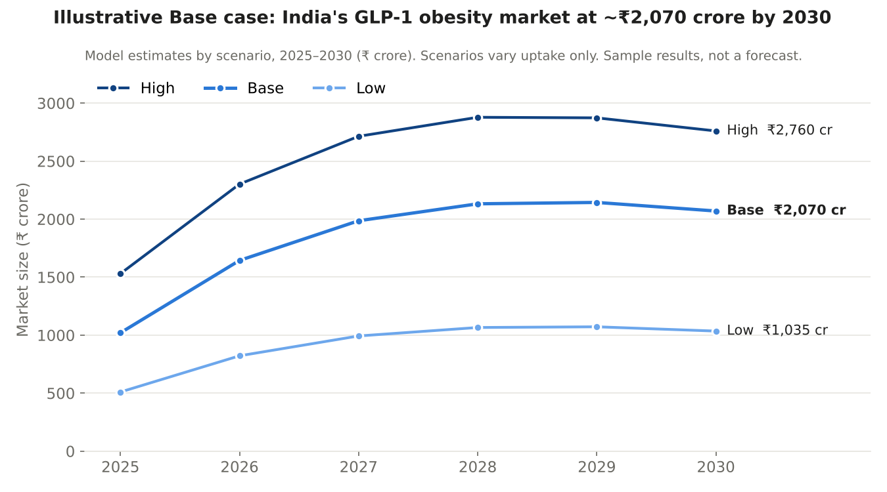
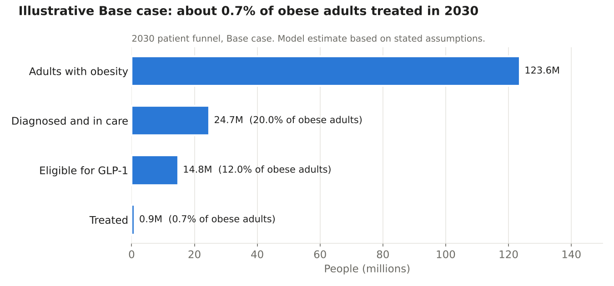

# India GLP-1 Obesity Market Sizing Model

> **Illustrative model, not a forecast.** All outputs are scenario estimates produced from public data and stated assumptions. They are sample results that show how the model works, not verified market figures. Several key inputs (diagnosis, eligibility and uptake rates) have no published India data and are assumptions; see [Assumptions](#assumptions) and [Limitations](#limitations).

**Question:** How large could India's GLP-1 obesity drug market be by 2030, and what drives that number?

**Illustrative answer:** Under the Base-case assumptions, the model estimates the market roughly doubling from ₹1,020 crore in 2025 to **₹2,070 crore (US$218 million) in 2030**, with about 890,000 patients on treatment. Across scenarios the 2030 estimate ranges from ₹1,035 crore to ₹2,760 crore.

## Key insights (illustrative)

These insights describe what the model's Base case shows under its assumptions. They are not verified findings.

1. **The market doubles, but patient numbers grow more than eightfold.** Base-case value grows from ₹1,020 crore to ₹2,070 crore (15% a year), while treated patients rise from about 104,000 to 890,000. The gap is price: generic semaglutide pushes the average monthly price down 76%, from ₹14,000 to about ₹3,300.
2. **Growth stalls by 2029 as falling prices offset volume.** The Base-case market peaks at ₹2,144 crore in 2029 and dips to ₹2,070 crore in 2030. After generic entry, revenue growth depends on adding patients faster than prices fall, which favours low-cost, high-volume players.
3. **The bottleneck is diagnosis and uptake, not disease prevalence.** India has about 124 million adults with obesity in 2030, but only 0.7% are treated in the Base case. Each extra percentage point of 2030 uptake adds about ₹345 crore to the market, so the biggest opportunity lies in getting more people diagnosed and treated.

## Method

A top-down model, projected for each year from 2025 to 2030:

> Adults 20+ × obesity prevalence × share diagnosed and in care × share eligible × uptake × annual cost per patient = market size

Annual cost per patient = monthly price × average months on treatment per year. Market size is reported in ₹ crore (1 crore = 10 million rupees) and US$ million.

Three scenarios (Low, Base, High) vary **uptake only**. All other inputs, including price, are held at Base values so the scenarios stay internally consistent. Price risk is tested separately on the Sensitivity tab.

## Scope

- **Geography:** India.
- **Population:** adults aged 20 and over with obesity (BMI ≥ 30).
- **Products:** GLP-1-based obesity drugs (semaglutide, tirzepatide and generic semaglutide), branded and generic combined.
- **Period:** 2025 to 2030.
- **Out of scope:** diabetes use of GLP-1 drugs, overweight adults with BMI 27–30, children and adolescents, and company-level market shares.

## Assumptions

| Input | Low | Base | High | Basis |
|---|---|---|---|---|
| Adults 20+ | 983M (2025) to 1,061M (2030) | same | same | UN World Population Prospects 2024 |
| Obesity prevalence | 8.8% (2025), growing 5.7% a year | same | same | NCD-RisC 2014–2024 trend |
| Diagnosed and in care | 20% | 20% | 20% | Assumption (no India data found) |
| Eligible for GLP-1 | 60% | 60% | 60% | Assumption (no India data found) |
| Uptake, 2025 → 2030 | 0.5% → 3% | 1% → 6% | 1.5% → 8% | Low GLP-1 awareness; calibrated to actual 2026 sales |
| Monthly price, 2025 | ₹14,000 | ₹14,000 | ₹14,000 | Between Wegovy and Mounjaro 2025 prices |
| Annual price change | −25% | −25% | −25% | Reaches ~₹3,300 by 2030, in line with generic prices |
| Months on treatment per year | 7 | 7 | 7 | US real-world persistence data (33–63% at one year) |
| Exchange rate | ₹94.8416 per US$ | same | same | RBI reference rate, 4 Nov 2026 |

**Calibration check:** India's total GLP-1 sales were about ₹2,333 crore in the 12 months to August 2026, covering both diabetes and obesity use. The model's 2026 obesity-only estimate is ₹822 crore (Low), ₹1,644 crore (Base) and ₹2,302 crore (High), all below that total.

## Limitations

- **Results are sample estimates, not verified findings.** They depend on the assumptions above and should not be used as a market forecast.
- **Diagnosis and eligibility are assumptions.** No published India data was found, and both directly scale the result.
- **Obesity figures are age-standardised.** NCD-RisC adjusts prevalence to a standard world population, so India's actual (crude) prevalence may differ slightly.
- **Women and men are averaged equally.** This assumes roughly equal adult numbers by sex.
- **Prices fell in one step in 2026, not gradually.** A constant 25% annual decline is a simplification of the generic launch in March 2026.
- **Persistence data is from the US.** Indian patients may stay on treatment for more or fewer months, especially when paying out of pocket.
- **Uptake rises in a straight line from 2025 to 2030.** Real uptake is likely to be uneven.
- **The calibration source is low trust.** The ₹2,333 crore figure comes from a trade website that does not name its data source, and it includes diabetes sales.
- **Out-of-scope groups are excluded.** Leaving out overweight adults and diabetes use understates the total GLP-1 market.

## Files

| Folder | File | Contents |
|---|---|---|
| `model/` | `India_GLP1_Market_Model.xlsx` | Workbook: README, Inputs, Scenarios, Model, Sensitivity, Sources |
| `data/` | `UN_WPP2024_India_population_by_age_2025_2030.csv` | India extract of UN population data, Medium variant |
| `data/` | `NCD_RisC_Nature_2026_BMI_age_standardised_India.csv` | NCD-RisC BMI prevalence for India, 1980–2024 |
| `data/` | `Sources.xlsx` | Every source, the value used, date accessed and trust level |
| `images/` | `market_by_scenario.png`, `funnel_2030.png` | Charts used in this README |

To use the model, open the workbook, pick a scenario in cell C3 of the Scenarios tab, and read the results on the Model tab. Yellow cells are inputs; everything else is calculated.

## Data sources

Trust levels: **High** = official or peer-reviewed; **Medium** = reputable secondary or industry source; **Low** = methodology not published, or no data.

| # | Used for | Source | Trust | Accessed |
|---|---|---|---|---|
| 1 | Adults 20+, 2025–2030 | [UN World Population Prospects 2024](https://population.un.org/wpp/), population by 5-year age group, Medium variant | High | 4 Nov 2026 |
| 2 | Obesity prevalence | [NCD-RisC](https://www.ncdrisc.org/data-downloads-adiposity.html), age-standardised BMI prevalence, India (Nature 2026) | High | 4 Nov 2026 |
| 3 | Obesity growth and 2025 prevalence | Calculated from source 2 | High | 4 Nov 2026 |
| 4 | Exchange rate | [Reserve Bank of India](https://www.rbi.org.in) reference rate | High | 4 Nov 2026 |
| 5 | Mounjaro prices | [PharmEasy, Mounjaro price in India](https://pharmeasy.in/glp-1/mounjaro/price/) (updated 1 Nov 2026) | Medium | 4 Nov 2026 |
| 6 | Wegovy and generic semaglutide prices | [BioPharma APAC, Semaglutide Generics, Six Months In](https://biopharmaapac.com/analysis/23/8540/semaglutide-generics-six-months-in-every-launch-in-india-every-price-and-where-china-stands.html) (9 Oct 2026) | Medium | 4 Nov 2026 |
| 7 | Price cuts after generic entry | [Business Today, Novo further cuts semaglutide prices](https://www.businesstoday.in/industry/pharma/story/novo-further-cuts-semaglutide-prices-as-generics-enter-india-523336-2026-03-31) (31 Mar 2026) | Medium | 4 Nov 2026 |
| 8 | Price assumption | Derived from sources 5–7 | Medium | 4 Nov 2026 |
| 9 | Months on treatment | [Prime Therapeutics, real-world GLP-1 persistence](https://www.primetherapeutics.com/documents/d/primetherapeutics/evt_ext_261001-a_amcppstr_trendsrealworldpersistence_r4-1) | Medium | 4 Nov 2026 |
| 10 | Uptake context (GLP-1 awareness) | [Kantar GLP-1 Opportunity Index, via Storyboard18](https://storyboard18.com/how-it-works/73-million-overweight-yet-glp-1-awareness-below-5-kantars-91032.htm) (1 Mar 2026) | Low | 4 Nov 2026 |
| 11 | Calibration (actual GLP-1 sales) | [World Pharma Today, India's ₹2,333 crore weight-loss drug story](https://www.worldpharmatoday.com/articles/indias-%E2%82%B92333-crore-weight-loss-drug-story-mounjaro-semaglutide-and-the-next-phase-of-competition/) (5 Oct 2026) | Low | 4 Nov 2026 |
| 12 | Obesity prevalence cross-check | [WHO Global Health Observatory](https://www.who.int/data/gho) (optional, not yet used) | High | – |
| 13 | Diagnosis and eligibility rates | Data not available; stated assumptions | Low | 4 Nov 2026 |

## Author

Devansh Fulara · [LinkedIn](https://linkedin.com/in/devanshfulara)
